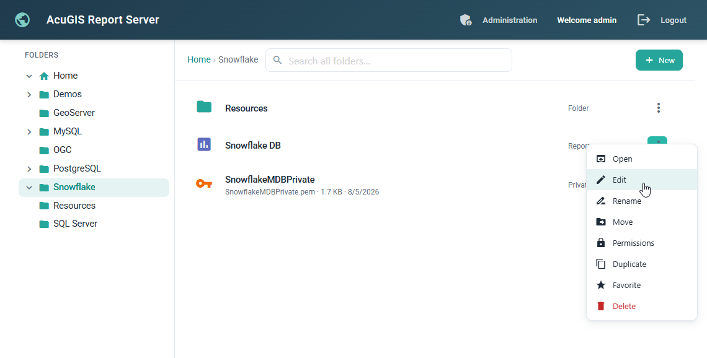
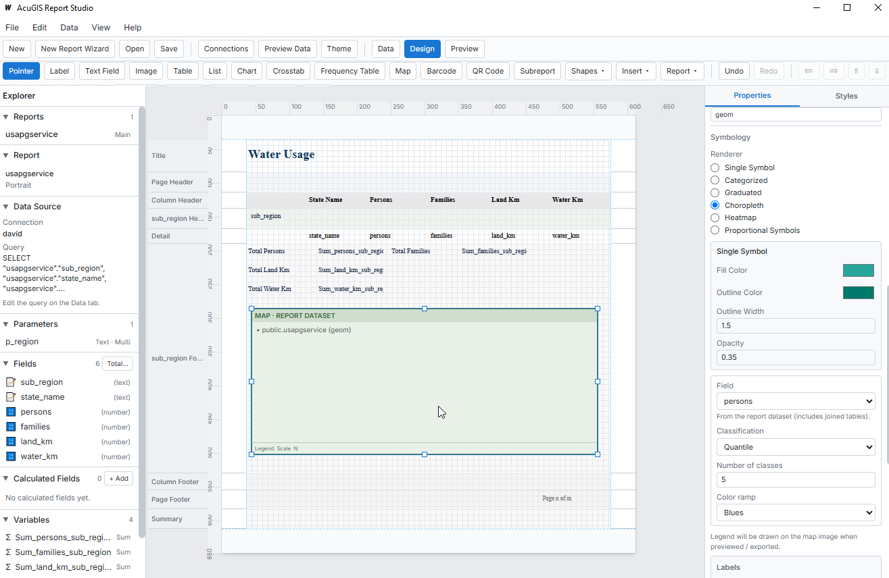

# AcuGIS Report Server 1.0.28

AcuGIS Report Server publishes, runs, and manages JasperReports. It provides a web catalog, scheduling, a versioned REST API, and client libraries for automation.

The server application is written in Go. JasperReports runs under Tomcat 10. PostgreSQL stores the application data. A native package deployment puts Apache in front of the Go process. Docker Compose is also supported.

Reports can be created using [AcuGIS Report Designer](https://www.acugis.com/report-designer/), Jaspersoft Studio, or other JRXML-compatible tools. AcuGIS Report Designer is available in Desktop and Web editions and provides a visual interface for creating reports with tables, charts, maps, parameters, and multiple data sources.

Report Designer is a separate commercial product. Designer Web can be integrated with Report Server when separately installed and licensed; a Report Server Professional license does not include Designer Web.





## Creating Reports

AcuGIS Report Server supports standard JasperReports JRXML templates. You can create reports using **Jaspersoft Studio**, **AcuGIS Report Designer**, or other JRXML-compatible tools.

### AcuGIS Report Designer

[AcuGIS Report Designer](https://www.acugis.com/report-designer/) provides a visual report builder for creating and editing JasperReports templates without manually writing XML.

Available in **Desktop and Web editions**, Report Designer includes:

- **Visual Report Builder** — Design reports with drag-and-drop elements, tables, charts, and parameters.
- **Multiple Data Sources** — Connect to PostgreSQL, MySQL, SQL Server, Oracle, SQLite, and more.
- **Maps and Charts** — Create geographic visualizations, charts, and data-driven reports.
- **JasperReports Compatibility** — Create and edit JRXML templates for publishing to Report Server.

**[Explore AcuGIS Report Designer](https://www.acugis.com/report-designer/)**



### Jaspersoft Studio

You can also use [Jaspersoft Studio](https://community.jaspersoft.com/) to create and edit JRXML reports. Reports created with Jaspersoft Studio can be uploaded, managed, scheduled, and executed using AcuGIS Report Server, subject to JasperReports engine compatibility.

*AcuGIS Report Designer is a separately licensed commercial product. Neither Designer nor Jaspersoft Studio is required to run AcuGIS Report Server.*


## Features

- JRXML catalog, publishing, and execution to PDF, Excel, HTML, and [other formats](documentation/docs/reference/supported-formats.md)
- Folders, resources, and report access control
- Scheduling, including email delivery
- REST API and OpenAPI, the `acugis-report` CLI, and SDKs for Python, .NET, Java, and Go
- Report embedding with short-lived embed tokens
- Local accounts, browser sessions, and personal access tokens
- The same datasource administration screen: PostgreSQL, MySQL, Oracle, SQL Server, Snowflake, SQLite, Cassandra, BigQuery, and DuckDB
- Embedded maps for PostGIS, MySQL, and GeoServer
- Audit recording when auditing is enabled
- QGIS, ArcGIS, Data Explorer, dashboards, Map Reports, Dataset Intelligence, audit administration, usage analytics, governance, audit export, OpenID Connect, SAML, and MCP are Professional features. Their source is not in this tree.

Edition boundaries are in the [compatibility matrix](documentation/docs/reference/compatibility-matrix.md). Datasource behavior is in [Supported datasources](documentation/docs/reference/supported-datasources.md).


## Architecture

| Piece | Role |
|-------|------|
| Go Report Server | Web UI and REST API. Packaged installs listen on port 9088. |
| Tomcat 10 | Runs the JasperReports engine that fills reports. |
| PostgreSQL | Application database. |
| Apache | Reverse proxy in the native package deployment. |
| Docker Compose | Runs the server, PostgreSQL, and a scheduler. |

The JasperReports WAR is the fill engine used by the package and by the Docker image. Installing that WAR by itself is not a Report Server installation.

The packaged site uses base path `/`. A native install reaches the Go process at `http://127.0.0.1:9088/`. When Apache is configured, it proxies public traffic to that address. Docker Compose publishes host port 9088.

## Editions

This repository is the AcuGIS Report Server Open Source source tree.

The Open Source server includes the catalog, execution, scheduling, datasources, local login, personal access tokens, report embedding, and embedded maps for PostGIS, MySQL, and GeoServer. Professional modules are not in this source tree. A license file cannot add them.

Professional is a separate proprietary product. Data Explorer, embedded QGIS, Map Reports, dashboards, Dataset Intelligence, audit administration, usage analytics, governance, audit export, OpenID Connect, SAML, and ArcGIS are not included here.

`ACUGIS_EDITION` does not activate Professional features.

See [Licensing](documentation/docs/administration/licensing.md) and the [compatibility matrix](documentation/docs/reference/compatibility-matrix.md).

## Quick start

AcuGIS Report Server Community Edition can be installed using Docker or the AcuGIS apt repository.

### Docker

Clone the Docker deployment repository and run the interactive setup:

```bash
git clone https://github.com/AcuGIS/report-server-docker.git
cd report-server-docker
docker compose run --rm -it report-server-setup
docker compose up -d
```

Once the services are running, open:

http://localhost:9088/

Login as user 'admin'.  An admin password is automatically generated and saved to:

```bash
<docker-compose-directory>/.env
```


### Debian / Ubuntu (apt)

Add the AcuGIS package repository and install Report Server:

```bash
sudo curl -fsSL https://apt.acugis.com/acugis-archive-keyring.gpg \
  -o /usr/share/keyrings/acugis-archive-keyring.gpg

echo "deb [arch=amd64 signed-by=/usr/share/keyrings/acugis-archive-keyring.gpg] https://apt.acugis.com stable main" \
  | sudo tee /etc/apt/sources.list.d/acugis.list > /dev/null

sudo apt update
sudo apt install acugis-report-server
```

Login as user 'admin'.  An admin password is automatically generated and saved to:

```bash
/etc/acugis-report-server/initial-credentials
```

For advanced installation, configuration, upgrades, and building from source, see the [Installation Guide](documentation/docs/administration/installation.md).

AcuGIS Report Server Professional is a separate commercial edition and is not built from this repository.

## Documentation

The MkDocs are available at [acugis.com/documentation/report-server](https://www.acugis.com/documentation/report-server/)


| Topic | Page |
|-------|------|
| Product overview | [Overview](https://www.acugis.com/documentation/report-server/getting-started/overview/) |
| Installation | [Installation](https://www.acugis.com/documentation/report-server/administration/installation/) |
| Add Data Source | [Quickstart](https://www.acugis.com/report-server/quick-start/#add-data-source) |
| Publish a report | [Quickstart](https://www.acugis.com/report-server/quick-start/#publish-report)) |
| Licensing | [Licensing](https://www.acugis.com/documentation/report-server/administration/licensing/) |
| Editions | [Compatibility matrix](https://www.acugis.com/documentation/report-server/reference/compatibility-matrix/?h=compat) |
| Authentication | [Authentication](documentation/docs/administration/authentication.md) |
| Report Designer Desktop | [Designer overview](https://www.acugis.com/report-designer/) 

## Development

`make run` in `go-report-server` starts the Open Source Go process (`-tags oss`). That is a developer run, not a product install. See [Developer checkout](documentation/docs/administration/installation.md#developer-checkout).

`install.sh` belongs to the release tarball. It is not a source-build installer.

The root `Makefile` builds the Open Source release artifacts. `package` and `deb` are the Open Source package targets.

## License

AcuGIS Report Server Open Source is licensed under the Apache License, Version 2.0. See [LICENSE](LICENSE). Copyright 2026 AcuGIS.

Professional is a separate proprietary product. Its source is not included in this tree.

Professional feature activation (`license.lic`) applies to that proprietary product. It is not the copyright license for this source tree. See [Licensing](documentation/docs/administration/licensing.md).

The client SDKs in `sdk/python`, `sdk/go`, `sdk/java`, `sdk/dotnet`, and `sdk/javascript` remain under their own MIT License. Copyright AcuGIS. Those MIT licenses do not license the server.
