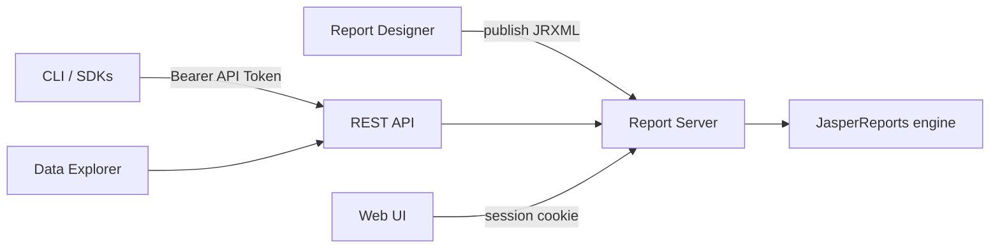

# Overview

AcuGIS Report Server is a JasperReports-based reporting platform with a web catalog, interactive viewers, and a versioned REST API for automation.

## Product components

| Component | Role |
|-----------|------|
| **Report Designer** | Desktop authoring for JRXML, Embedded Maps, and Map Reports. |
| **Report Server** | Hosts the catalog, executes reports via JasperReports, manages folders/resources/datasources, and exposes REST + OpenAPI. Published as Open Source and Professional packages. |
| **Data Explorer** | Browser-based analysis over tables or report query result sets. In the Professional package before a license is activated; not in the Open Source package. |
| **CLI** (`acugis-report`) | Cross-platform command line built on the Python SDK. Talks only to the REST API. |
| **SDKs** | Python, .NET, Java, and Go clients for the same REST contract. |

## What you can do

- Publish and update JRXML reports with datasources and access groups
- Run reports to PDF, Excel, HTML, and other [supported formats](../reference/supported-formats.md)
- Organize content in folders with ACL permissions
- Store images and other resources used by reports
- Configure datasource connections and regenerate Jasper `context.xml` where the engine uses JNDI
- Debug **Embedded Maps**. Open Source includes PostGIS, MySQL, and GeoServer. A Professional package without a license also includes QGIS. ArcGIS requires a valid license. **Map Reports** are separate and require a licensed Professional package
- Explore data interactively on the Professional package and export results
- Automate CI with `ACUGIS_REPORT_URL` and `ACUGIS_REPORT_TOKEN`

## Open Source and Professional

JDBC and the other engines in the datasources UI are available on both packages. They are not the edition boundary.

The Open Source package is the `-tags oss` build. It includes embedded PostGIS, MySQL, and GeoServer. The Professional package adds Data Explorer and embedded QGIS before a license is activated. Map Reports, dashboards, Dataset Intelligence, MCP, ArcGIS, and the other license-gated modules require a valid license. `ACUGIS_EDITION` does not grant features.

See the [compatibility matrix](../reference/compatibility-matrix.md).

## Documentation map

| Audience | Start here |
|----------|------------|
| Everyone | [Quickstart](quickstart.md), [Concepts](concepts.md) |
| Report users | [User Guide](../user-guide/index.md) |
| Administrators | [Installation](../administration/installation.md), [Configuration](../administration/configuration.md) |
| Developers | [Developer Guide](../developer/overview.md) |
| Lookup | [Reference](../reference/environment-variables.md) |
