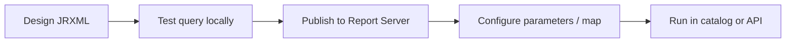

# Report Designer overview

**Report Designer** is the desktop authoring environment for JasperReports used with AcuGIS Report Server. You design JRXML layouts, queries, parameters, subreports, Embedded Maps, and Map Report pairings, then publish to Report Server.

## Editions on Report Server

Report Server does not edition-gate the engines in the datasources UI (PostgreSQL, MySQL, Oracle, SQL Server, Snowflake, SQLite, Cassandra, BigQuery, and DuckDB). Data Explorer and embedded QGIS are in the Professional package before a license is activated, and are absent from the Open Source package. Map Reports, the ArcGIS Designer provider, and the Designer providers GeoServer and QGIS require a valid license on the Professional package. Connection administration is a separate check. See the [compatibility matrix](../../reference/compatibility-matrix.md).

!!! important "Db2"
    `db2` is not offered in the Report Server datasources UI, and Jasper context generation skips it. Db2 Spatial map loading in Data Explorer is a separate provider and requires a configured Db2 driver. Do not treat Db2 JDBC and Db2 Spatial as the same datasource.

## Typical workflow

1. Create or open a JRXML in Report Designer.
2. Point Connection Manager at the same logical names you will use on Report Server (datasource name, GeoServer connection name, ArcGIS connection name).
3. Publish via Designer integration or automation (`acugis-report reports publish` / REST).
4. Verify in the catalog viewer; use Embedded Map debug or Map Report flows as needed.

## Alignment with Report Server

- Datasource **names** must match between Designer Connection Manager and Report Server (and Tomcat JNDI / `context.xml` where the engine uses JNDI).
- GeoServer credentials for authenticated layers are configured on the **server** admin UI (same **Name** as Designer). That GeoServer page is on both packages. The ArcGIS connection page is mounted only in the Professional package and requires the ArcGIS Designer provider entitlement. There is no REST CRUD for those connection tables today.
- Report keys, parameters, and resource UUIDs are server-side identities — keep JRXML parameter names stable for API callers.

## Designer Web

Designer Web is a separate browser editor that Report Server can reverse-proxy. It is not this desktop application, and a Report Server Professional license does not enable it. Attachment, routes, and licensing are in [Designer Web](../../administration/designer-web.md).

## Related

- [JRXML compatibility](jrxml-compatibility.md)
- [Publishing](publishing.md)
- [Compatibility matrix](../../reference/compatibility-matrix.md)

---

## For Developers

| Integration path | Go here |
|------------------|---------|
| Publishing via CLI/REST | [Publishing a report](../../developer/tutorials/publishing-a-report.md) |
| CI automation | [GitHub Actions / CI](../../developer/tutorials/github-actions.md) |
